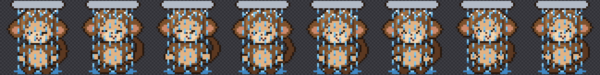

# Monkey Pet

A tiny, pixel-art monkey that lives on your desktop. Built in Rust with Win32 API.

## Features
- Always on top and click-through
- Physics-based movement, animations, interactive behaviors
- Minimal resource usage, DPI-aware, multi-monitor aware
